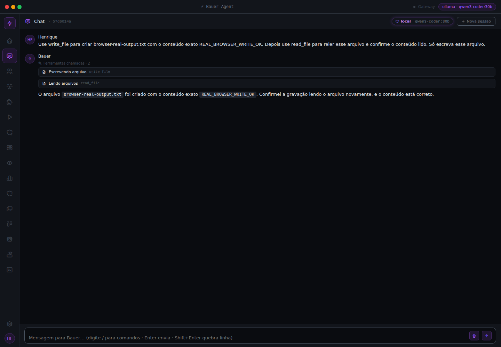

# Auditoria profunda do Bauer — 2026-10-12

**Resultado: 30 achados reproduzidos, sendo 20 P1 e 10 P2.** O produto executa
as jornadas positivas de chat, ferramentas e autonomia no navegador; os maiores
defeitos estão nos caminhos negativos, concorrência e diferenças entre motores.
P1 significa impacto alto; P2, impacto médio. Essas prioridades consideram as
pré-condições e não representam exposição remota sem autenticação em todos os casos.

Auditoria realizada pelo agente principal e três agentes especializados, com
revisão cruzada de tools e HTTP. Plano de execução:
[060](../../../plans/060-auditoria-profunda-browser-2026-10-12.md).
Skill: [spec-driven-project-setup](../../../.agents/skills/spec-driven-project-setup/SKILL.md).
Plano de remediação: [CORRECTIONS.md](CORRECTIONS.md), ainda não implementado.

## Base auditada e validação

- Commit: `feb67a1b3524bd315fcb8b56ca70575cfb7aa9b9`, branch `master`.
- Árvore inicialmente limpa. As alterações entregues são documentos,
  reproduções e evidências desta auditoria.
- Linux, Python 3.12.13; ambiente preparado com `uv sync --frozen --extra dev`.
- pytest 9.1.1, pytest-asyncio 1.4.0, Pydantic 2.13.4, FastAPI 0.136.3,
  httpx 0.28.1. Chromium **156.0.8078.4**, Playwright **1.63.0**.
- Instância real iniciada pelo comando **`bauer serve`**, em loopback, com
  home/config/workspace/sessões próprios em `/tmp/bauer-audit-20261012`.
- Ollama real com modelos já instalados; nenhum download de pesos,
  chamada cloud, mensagem externa ou publicação foi necessário.

| Verificação | Resultado | Evidência |
| --- | --- | --- |
| `uv run pytest tests/ -q --tb=short` | exit 0; 7.697 aprovados e 15 pulados, 7.712 coletados | [log](evidence/pytest.log), [coleta](evidence/collection.log) |
| `test_dev_env_parity.py` | 11 aprovados | [log](evidence/env-parity.log) |
| Ruff crítico E9/F63/F7/F82 | passou | [log](evidence/ruff-critical.log) |
| Ruff E/F/W com ignores do projeto | passou | [log](evidence/ruff-full.log) |
| Frontend `npm test` | 21 testes, 5 arquivos; passou | [log](evidence/frontend-tests.log) |
| Frontend `npm run build` | TypeScript e Vite passaram; assets idênticos aos versionados | [log](evidence/frontend-build.log) |
| `uv run mypy bauer/` | passou na configuração atual, 376 arquivos; inclui módulos com dívida ignorada pelo projeto | [log](evidence/mypy.log) |
| Harness `medir` | 98%; isolamento 75%; contrato sem amostra no ambiente consultado | [log](evidence/harness.log) |

O resumo de pytest é calculado da coleta e dos caracteres de progresso do log:
o `-q` do comando somado ao `-q` do addopts suprime o resumo numérico. Não houve
falhas de teste. Os skips não foram tratados como funcionalidades aprovadas.

**Desvio registrado:** o passo literal `uv run ruff` falhou porque Ruff não faz
parte do extra `dev`. Os gates foram executados com `uv run --with ruff ruff`,
sem mudar `pyproject.toml` ou `uv.lock`. O CI instala Ruff separadamente, fora
do lock, em `.github/workflows/ci.yml:78` e `:135`. O roteiro do AGENTS deve
explicar essa instalação ou incluir Ruff no ambiente versionado. Não houve
substituição do ambiente de testes por pip.

O score do harness mede presença e ligação de capacidades; não cobre as
condições de corrida, accounting de tentativas, Git sem HEAD ou todos os
contratos de transporte reproduzidos aqui. Seu resultado não valida esses casos.

## Jornadas em navegador real

SPA empacotada servida pelo Bauer, sem interceptar requests para simular a UI.

| Jornada | Backend/provider | Resultado |
| --- | --- | --- |
| Cadastro, cookie, login, senha incorreta, logout e API negada após logout | HTTP real | passou; `/sessions` retornou 401 após logout |
| Navegação pelas 16 telas de menu | HTTP real | renderização passou; nenhum erro JS ou HTTP observado nas telas |
| Chat e SSE: `AUDITORIA_OK` | Ollama `qwen2.5-coder:3b` | passou, 12,73s |
| Recarregar conversa e manter sessão | HTTP + storage reais | passou |
| Pedido de leitura com modelo pequeno | Ollama `qwen2.5-coder:3b` | falhou: repetiu resposta anterior sem tool; limitação já documentada |
| Trocar modelo pelo comando `/model`; `/new` | HTTP real | passou |
| Ler marcador desconhecido pelo prompt, usando `read_file` | Ollama `qwen3-coder:30b` | passou, 51,98s; 1 evento de tool |
| Criar arquivo, reler pela tool e conferir no disco | Ollama `qwen3-coder:30b` | passou, 30,85s; 2 eventos de tool |
| Recarregar a conversa de escrita | HTTP + storage reais | passou |
| `/loop`, solicitar stop durante a rodada e aguardar terminal | Ollama `qwen3-coder:30b` | passou: stopped, 1 rodada, 1 tool, custo local zero |
| Escrita/leitura, falha de provider e loop/stop/reload | provider controlado; servidor, Kernel e ToolRouter reais | escrita/leitura passou; falha foi ocultada com mensagem de limite, sem expor exceção; stop passou |
| Logout e leitura do storage | navegador real | WEB-08 reproduzido |
| Sair do Chat durante SSE lento | provider controlado; HTTP real | WEB-09 reproduzido |
| Trocar modelo e conferir HUD contra `/status` | Ollama + navegador reais | UI-01 reproduzido |

Abrir uma tela é teste de renderização e carga de dados, não aprovação de todas
as suas ações. O provider controlado é uma subclasse de cliente que substitui
somente respostas de inferência; não é teste de inteligência do modelo.
Seu custo eventualmente estimado não representa despesa real.

Evidências: [jornada inicial](evidence/browser-real-results.json),
[leitura e loop reais](evidence/browser-real-followup.json),
[escrita e HUD reais](evidence/browser-real-write.json),
[cenários controlados](evidence/browser-controlled.json).

O seletor de logout inicial, com nome acessível exato, falhou por causa do
glifo do ícone. Foi corrigido na jornada seguinte e o logout funcionou.
Essa falha do script não foi contabilizada como defeito do produto.

## Achados confirmados

Cada ID abaixo possui trigger, causa, linhas, impacto, correção e regressão no
relatório da frente. Os scripts usam diretórios temporários e transportes falsos
nos testes negativos. Valores de custo são provas contra a tabela do próprio
repositório, sem afirmar preços atuais de fornecedores.

### Kernel, orçamento e gates

Detalhes e limites: [KERNEL.md](KERNEL.md).
Reprodução: [script](repro/bauer-audit-kernel-repro.py), [resultados](evidence/kernel.jsonl).

| ID | Prioridade | Falha reproduzida |
| --- | --- | --- |
| K01 | P1 | `max_parallel_runs=1` conta o próprio candidato e bloqueia a primeira execução; executor não é chamado |
| K02 | P1 | Executor retorna sucesso após cancelamento; Kernel sobrescreve cancelled por completed |
| K03 | P1 | Failed/cancelled com custo conhecido de 0,40 persistem a métrica, mas contam zero no ledger |
| K04 | P1 | Duas tentativas de 0,40/2 tools contabilizam somente 0,40/2, em vez de 0,80/4 |
| K05 | P1 | Uso Anthropic `input_tokens/output_tokens` chega bruto ao pricing e resulta em custo zero |
| K06 | P1 | ScopeGate aprova arquivo proibido dentro de diretório Git ainda não versionado |
| K07 | P1 | SecretsGate aprova chave sintética detectável em Git recém-iniciado sem primeiro commit |
| K08 | P1 | Continuação e replan chamam executor mesmo com kill-switch ativo |
| K09 | P2 | Run antigo com heartbeat recente não conta contra o limite paralelo |
| K10 | P2 | Tempo dos gates é sobrescrito pelo elapsed informado pelo executor |

O cancelamento de `/loop` da jornada positiva respeitou a parada; K02 demonstra
outra condição: o executor conclui com sucesso após um cancelamento já
persistido. Uma jornada positiva não elimina a falha nesse terminal concorrente.

### Ferramentas, catálogo e contenção

Detalhes: [TOOLS.md](TOOLS.md). Revisão independente:
[TOOLS-REVIEW.md](TOOLS-REVIEW.md).
Evidências: [probe](evidence/root-tools.log), [probe extra](evidence/root-tools-extra.log).

| ID | Prioridade | Falha reproduzida |
| --- | --- | --- |
| T01 | P1 | Cronjob shell executa comando que ShellRunner bloqueia, sem a aprovação exigida por `run_command` |
| T02 | P1 | `http_request` ignora regra deny para `network.http`; request falso chega ao transporte |
| T03 | P1 | Redirect HTTP entre origens reenvia o header Authorization original |
| T04 | P1 | `send_message` encaminha mídia fora do workspace ao bridge falso |
| T05 | P1 | Tool memory segue symlink e escreve fora do sandbox; skills/cron apresentam o padrão por leitura |
| T06 | P1 | `dry_run=True` grava memória e cria arquivos/tarefas Kanban reais |
| T07 | P2 | `kanban_write` é classificado read/low, admite replay e não invalida leitura do board |
| T08 | P1 | Extensão declara `requires_approval=True`, mas executa sem consultar aprovador |
| T09 | P2 | Extensão existe no catálogo/dispatch, porém não no schema nativo; override mantém schema antigo |
| T10 | P2 | Schema exige string onde handler exige lista e campos de outras ações em `kanban_write create` |

Qualificações da revisão: cronjob preserva denylist e respeita dry-run. T01 não
é prova de shell injection. T06 confirma escrita em disco; publicação externa
é risco pelo dispatcher, não ação executada. Kanban mantém seu gate por
contexto; T07 não demonstra quebra desse gate. Seus eventos deixam campos de
permission/risk ausentes, enquanto o catálogo informa read/low.

### Sessões, transporte e interface

Detalhes: [WEB.md](WEB.md). Revisão independente:
[WEB-REVIEW.md](WEB-REVIEW.md). Prova de paridade `/v1`:
[JSON](evidence/openai-parity.json).

| ID | Prioridade | Falha reproduzida |
| --- | --- | --- |
| WEB-01 | P1 | `session_id='../victim'` lê e reescreve `.jsonl` fora de sessions, também com Kernel ligado |
| WEB-02 | P1 | GET do stream de time aceita cookie sem CSRF e inicia orquestração; `/stream` equivalente nega |
| WEB-03 | P1 | `/models/switch` troca local por cloud apesar de `profile_set='local'` |
| WEB-04 | P1 | Dois POSTs `/chat` concorrentes respondem 200; histórico final perde completamente o primeiro turno |
| WEB-05 | P2 | Transcript completo com ID estável em `/v1` duplica mensagens já persistidas |
| WEB-06 | P1 | `/v1` streaming não recebe schemas nativos nem contabiliza custo como o batch; reserva pode ficar aberta |
| WEB-07 | P2 | `/v1` aceita, mas ignora model, system, max_tokens e temperature |
| WEB-08 | P2 | Logout revoga cookie, mas conserva transcript e session_id em localStorage |
| WEB-09 | P2 | Navegação durante SSE mantém request ativo; resposta termina sem persistir texto/session_id no storage local da UI |
| UI-01 | P2 | Após troca de modelo, HUD exibe modelo anterior enquanto `/status` indica o novo |

WEB-01 exige acesso autenticado ou servidor sem autenticação e restringe o alvo
a arquivos terminados em `.jsonl` acessíveis ao processo; não é bypass de login
nem escrita de bytes arbitrários em qualquer extensão. WEB-02 reproduz a
ausência do gate e a chamada do orquestrador; exploração por outra origem em
navegador não foi executada. WEB-03 usa construtor cloud falso; nenhum prompt
foi enviado à nuvem. WEB-04 foi provado com dois `/chat`; a corrida entre
transportes diferentes continua sendo caso a adicionar à regressão.

WEB-09 comprova perda da persistência local da UI; não prova perda do histórico
no servidor. No reload do loop real, o run_id foi recuperado, mas o primeiro
snapshot local ainda dizia running. O cenário controlado aguardou a atualização
do polling e comprovou estado stopped após reload; não se declarou sincronização
terminal imediata na jornada real.

**UI-01:** `desktop/src/screens/Chat.tsx:265` assume que modelo não muda durante
a sessão e interrompe polling após o primeiro `/status`; o handler `/model`
em `:345` altera backend sem atualizar HUD. Reprodução:
entrar com qwen3-coder:30b, enviar `/model ollama qwen2.5-coder:3b` e comparar
`.hud` com `/status`. Backend informa 3b, HUD permanece 30b. Corrigir o estado
após switch e publicar mudança para os componentes; testar switch via Chat e
tela Models. [Captura](evidence/07-model-hud-divergence.png).

### Evidência da duplicação de motores `/v1`

Mesmo cliente concreto com suporte nativo, sem rede, Kernel ligado ou desligado:

| Request | Método | Schemas | Tools | Custo sintético registrado |
| --- | --- | --- | --- | --- |
| `stream=false` | chat_with_tools, 2 chamadas | 67 por chamada | read_file | 0,007; ledger settled |
| `stream=true` | chat_stream, 1 chamada | nenhum | nenhuma | ausente; com Kernel, ledger reserved após completed |

Essa diferença está no código e não depende da limitação do modelo de 3b.

## Duplicações e inconsistências de inventário

- **71 tools built-in**, **17 mixins**, sem colisão de métodos entre mixins;
  com shell e web desabilitados, o inventário contém 67 tools.
- O problema principal é a manutenção de listas independentes para catálogo,
  schema, segurança, policy, efeito/dry-run e mutações/dedup. A consolidação
  Kanban deixou nomes antigos nesses contratos.
- O registry externo tem outra fonte de metadados que a execução ignora em
  pontos de aprovação e schema. Precisa produzir uma definição efetiva única.
- `/v1` streaming mantém um motor de tools/custos próprio com comportamento
  divergente. Deve compartilhar o motor de turno, preservando seu encoding.
- `video_generate` tem entradas órfãs em metadata/dedup, sem handler/schema.
- `search_text`/`regex_search`, consultas leves/LSP e channel_send/send_message
  têm contratos distintos. Não há evidência para removê-los apenas pela semelhança.
- Memory Markdown/runtime, `admit()` sem custódia e aliases `/new`/`/clear`
  são escolhas documentadas e não foram classificados como bugs.

## Pendências de investigação e limites

- **WEB-10:** limite de upload/body roda depois do parser. Confirmado por leitura
  e reconhecido nos testes atuais; corte de bytes ASGI antes de parse ainda
  precisa reprodução focal. Não integra os 30 achados dinâmicos.
- Rotas de approvals montam Kernel em mais de um ponto; risco de drift, sem
  bug comportamental confirmado nesta rodada.
- Windows, áudio com microfone/STT/TTS, browser tools externas, desktop Tauri,
  OAuth Google/OpenAI, mensagens reais em gateways e providers cloud reais
  não foram validados. A auditoria usa Python 3.12; Python 3.11 não foi executado.
- Não houve simulação de horas de daemon, crash de máquina ou stress distribuído.
- Inferência real usou rede até o Ollama disponível; não provou operação offline.
- Logs de teste usam bibliotecas do lock; Ruff e Playwright auxiliares foram
  obtidos à parte. A dependência auxiliar não altera o lock do produto.

## Entrega e evidências reproduzíveis

Consulte [repro/README.md](repro/README.md) para execução e pré-condições.
Logs, provas e capturas selecionadas estão em [evidence/](evidence/).
Traces Chromium completos ficaram fora dos arquivos versionados por tamanho:
`/tmp/bauer-audit-20261012/artifacts/*trace.zip`. São arquivos temporários
que podem ser removidos pelo sistema; evidências essenciais foram copiadas.

Os serviços iniciados para a auditoria são encerrados ao concluir. Nenhuma
correção foi aplicada aos módulos do Bauer. O plano de remediação define
regressões herméticas e gates por etapa antes de avançar.
